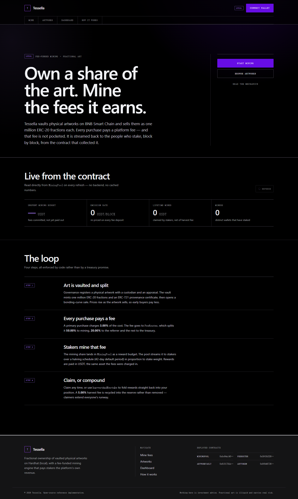

# Reskin report — Tessella (website/)

Generated by the `reskin` pipeline for `@tessella/website` (Vue 3 + Vite + Pinia + vue-router).
The reskin was run against a fresh frozen baseline of the current **Orbital / Bubblegum** shell in
`.reskin/baseline/`. The previous reskin run (and its superseded report) was moved to
`../.reskin-archive-2026-10-20/` before this run; everything in this `.reskin/` directory is the
authoritative post-rebrand baseline and evidence.

## Direction

| | |
|---|---|
| Style | **Agora Violet** (`polygon-agora`, technical-editorial) |
| Source DNA | [https://polygon.technology](https://polygon.technology) — sampled live (1228 ms) |
| Skeleton | **Documentary Ledger** (`documentary`, editorial) |
| Implemented / detected | `marketing-stack` (editorial) — the classifier's closest bucket for the masthead/index/lede composition; the original family was `spatial` |
| Original | `orbital` / `spatial`, light `#ffffff`, accent `#e6006f` |
| New ground | near-black `#000000` with a violet bloom |
| New accent | `#670de5` (text-safe `#a97bff`) |
| Accent distance | **94.44 ΔE** (threshold 30) |
| Selection seed | `1aac010745e1c5e39ffb6a58786aaa86ea679844ee218f02758c02291c83a7f7` |
| Live sampling | 9/10 blockchain references answered; Arbitrum returned HTTP 403 |
| Selection | automatic; no style, palette, layout or route choices were asked of the user |

The selector sampled Base, Polygon, Solana, Ethereum, Uniswap, Optimism, Aave, Cosmos and Sui
live, scored every catalog direction against the current accent/ground, and chose Agora Violet
(83.7 ΔE from the current accent, nearest editorial skeleton). No reference logo, image, copy or
code was downloaded or reused — only palette, type mood, shape language, texture, density, motion
and layout grammar.

## What changed

The old shell was a warm-white **orbital** composition: round brand orb, a beaded arc of route
pills, a huge concentric core beside the hero, rounded metric cards, and a three-column
outer-ring footer. The new shell is a **typed ledger**:

- **Masthead + index line.** A square mono monogram, wordmark, chain chip and wallet dock sit on a
  ruled masthead; the four routes are uppercase mono index entries on one rule, on a 2×2 ruled
  grid on phones. There are no pills, no filled app bar and no arc.
- **Opening spread.** The statement spans 8 of 12 columns with the lede below it; actions sit in a
  narrow marginalia column beyond a hairline rule. The decorative concentric core is gone.
- **Registers, not cards.** Metrics are four ruled figure entries (label, large tabular figure,
  provenance note) with a 2px release meter. Every surface has square corners, a top rule and no
  elevation. Notes are left-ruled marginal notes, not rounded callouts.
- **Loop and pools as textual runs.** The four steps are a single ruled run with a tag column and a
  copy column; pools are roster rows. The old 2×2 petal cards and pod cards are gone.
- **Catalogue as lots.** `/art` is a prologue plus ruled catalogue lots, each with a definition
  ledger for appraised value, marginal price, sold, next share and holding, instead of a card
  shelf.
- **Docs as a document.** The sticky left index aside became a horizontal contents line above a
  single editorial column with numbered chapter rules, ledger tables, code blocks and marginal
  notes.
- **Colophon.** The footer is a printed colophon: brand note, route shortcuts, contract register
  and legal line over a two-rule base — not an outer ring.

### Files

Added:

- `src/styles/ledger.css` — single token/layout/component stylesheet (`--ag-*`, `ag-*`).
- `src/components/ledger/RouteIndex.vue` — ruled route index (same routes and labels).
- `src/components/ledger/ColophonFooter.vue` — same copy, contract chips, links and legal line.
- `src/components/ledger/FigureEntry.vue` — same `label` / `value` / `unit` / `sub` / `accent` /
  `loading` contract as the old bead.

Rewritten (templates only; scripts/data/bindings preserved):

- `src/App.vue`, `src/main.ts`
- `src/views/HomeView.vue`, `ArtView.vue`, `ArtworkDetailView.vue`, `DashboardView.vue`,
  `DocsView.vue`, `MineView.vue`
- `src/components/TxFeed.vue`, `ConnectBanner.vue`, `ConnectPrompt.vue`, `WalletButton.vue`,
  `WalletModal.vue`

Removed from the render path and deleted:

- `src/components/orbit/OrbitRouteArc.vue`, `OrbitFooter.vue`, `OrbitBead.vue`
- `src/styles/orbit.css`

`index.html` changed only in the favicon data-URI colour (`#e6006f` → `#670de5`) and corner radius;
title, description and language are untouched.

## Evidence

Verification command (the extra bridge/stub are verification-only tooling, not app code):

```bash
node node_modules/vite/bin/vite.js build
node "C:\Users\Administrator\.dsh\skills\reskin\scripts\verify.mjs" check \
  --project "E:\workspace\chuangye\solana\zero\website" --out .reskin \
  --url http://127.0.0.1:4321/ --no-build
```

The app uses `createWebHashHistory()`; `verify.mjs` builds path URLs, which collapse every route
to home. The baseline was therefore recaptured before any edit through
`.reskin/tools/hash-server.mjs`, which answers extension-less paths with a 302 to `/#/path`.
Without that fix the earlier run compared home against home for every route. A local pending
JSON-RPC socket (`.reskin/tools/rpc-stub.cjs`) on the configured Hardhat endpoint keeps the
unavailable local node from raising `ERR_CONNECTION_REFUSED` console errors; it is not imported or
bundled.

| Gate | Result |
|---|---|
| Source content contract | **PASS** — intact, 1003 text tokens, 406 bindings, hash `4fb49879ad09…` |
| Rendered content parity | **PASS** — no missing or added words/attributes/forms on any static route |
| Skeleton replacement | **PASS** — `orbital`/`spatial` → `marketing-stack`/`editorial` |
| Accent distance | **PASS** — 94.44 ΔE (min 30) |
| CSS class overlap | **PASS** — 0.0% / 1.8% / 1.9% / 1.4% / 1.7% (max 10%) |
| Route health | **PASS** — 5/5 static routes HTTP 200, 0 console errors, 0 page errors |
| Contrast | **PASS** — 792 text/background pairs checked, 0 failures |
| Labels / alt / accessible names | **PASS** — 0 field, image or interactive-control issues |
| Horizontal overflow | **PASS** — 0 document overflow at 1440×900 and 390×844 |
| Keyboard focus | **PASS** — visible focus indicator on every sampled tab stop |
| Mobile navigation | **PASS** — all four route targets reachable at 390 px |
| Axe WCAG 2.x (manual run) | **PASS** — 0 violations on `/`, `/art`, `/dashboard`, `/docs`, `/mine` |
| Build | **PASS** — production Vite build |

Per-route structure:

| Route | Result | DOM similarity | Landmark similarity | Class overlap | Contrast pairs |
|---|---|---:|---:|---:|---:|
| `/` | PASS | 0.452 | 0.600 | 0.000 | 70 |
| `/art` | PASS | 0.463 | 0.600 | 0.018 | 43 |
| `/art/:id` | skipped (dynamic) | — | — | — | — |
| `/dashboard` | PASS | 0.320 | 0.600 | 0.019 | 60 |
| `/docs` | PASS | 0.283 | 0.571 | 0.014 | 563 |
| `/mine` | PASS | 0.333 | 0.600 | 0.017 | 56 |

The only warnings are accessibility-label deltas: the new named `section` landmarks
(`aria-label` additions) and the removal of `aria-label="Footer"` because the colophon shortcut
list is no longer a second navigation landmark. Every visible footer link and label remains.

## Screenshots

Baseline (the previous orbital UI) and current (Agora Violet) were both inspected directly:

| Route | Baseline | Current |
|---|---|---|
| `/` | [baseline](baseline/home-desktop.png) · [mobile](baseline/home-mobile.png) | [current](current/home-desktop.png) · [mobile](current/home-mobile.png) |
| `/art` | [baseline](baseline/art-desktop.png) · [mobile](baseline/art-mobile.png) | [current](current/art-desktop.png) · [mobile](current/art-mobile.png) |
| `/dashboard` | [baseline](baseline/dashboard-desktop.png) · [mobile](baseline/dashboard-mobile.png) | [current](current/dashboard-desktop.png) · [mobile](current/dashboard-mobile.png) |
| `/docs` | [baseline](baseline/docs-desktop.png) · [mobile](baseline/docs-mobile.png) | [current](current/docs-desktop.png) · [mobile](current/docs-mobile.png) |
| `/mine` | [baseline](baseline/mine-desktop.png) · [mobile](baseline/mine-mobile.png) | [current](current/mine-desktop.png) · [mobile](current/mine-mobile.png) |

Clip views used for the long docs page and extra probes live in `review/`:
`docs-top.png`, `docs-index2.png`, `docs-mid.png`, `docs-mobile-top.png`,
`art-detail-loading.png`, `wallet-modal.png`.

### Visual originality review

- **Ground:** warm white/pink bloom → near-black with a single violet bloom. First viewport reads as
  a different product.
- **Navigation:** route pills on a beaded arc → an uppercase mono index line under the masthead;
  on mobile a ruled 2×2 grid, not a collapsed sidebar or drawer.
- **Hero:** left copy plus a giant concentric core → an 8/3 editorial spread with a marginal action
  column and no illustration object.
- **Rhythm:** rounded cards and pillars → hairline rules, square corners, mono metadata and
  tabular figures; metric cards became a ruled figure ledger.
- **Docs:** sticky sidebar index + stacked cards → horizontal contents line + continuous document
  column.
- **Silhouette:** no shared card grid, hero silhouette, pill nav or footer arc remains. The only
  inherited brand token is the wordmark itself, which is content.



## Accessibility and responsiveness

- One `h1` on every static route; chapter `h2`/`h3` hierarchy retained.
- Named `section` landmarks plus `role="banner"` masthead, one `nav` route index and a `footer`
  colophon. Every control has an accessible name; forms keep their `label for` pairs, ids and
  `name`/`type` semantics.
- `:focus-visible` ring on every link, button, input and meter-adjacent control; tab traversal
  shows a visible indicator.
- Contrast: ink `#f2f3f7`, soft ink `#c9c7d4` and muted `#a0a1a6` on `#000000`/`#141415`; the
  violet accent is used for large shapes/fills, while `#a97bff` is used for accent text.
- 390 px: single-column figures, 2×2 route index, stacked lot ledgers, wrapped contents line,
  one-column colophon; no horizontal document overflow. Wide ledger tables scroll inside their
  own block rather than the page.
- `prefers-reduced-motion: reduce` disables sweeps, spins and transitions.

## Known limitations

- **Dynamic route:** `/art/:id` is skipped by the pipeline (it needs a concrete fixture id and a
  live vault). The route and full template were rebuilt and the page was probed at `/art/0`:
  it renders the skeleton state with 0 console/page errors. With a live RPC and a registered
  artwork it renders the plaque, curve ledger, buy questionnaire and settlement ledger.
- **Chain state:** the local Hardhat node at `127.0.0.1:8545` is not running in this workspace, so
  every capture shows the first-read state (0/— figures), exactly as the frozen baseline does.
  Live figures were not fabricated. The RPC stub used for verification never answers, so the UI
  remains in the same loading state for baseline and current.
- **Hash history capture:** the verification bridge is tooling only; the app's routing mode was not
  changed. It is documented here because a plain `verify.mjs` run would silently measure home for
  every route.
- **Content tokens:** all copy, labels, placeholders, link targets, `v-model`/handler expressions,
  API/env names and form signatures were moved, never rewritten. `aria-label` additions are the
  only new strings and they describe the new landmarks.

The UI was rebuilt around **Agora Violet** / **Documentary Ledger**; the original **orbital** shell
and palette were removed while the content contract stayed byte-for-byte intact.
